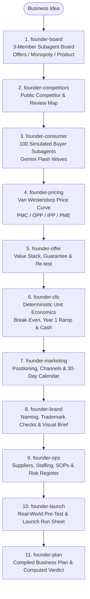

# Gemini Founder Skill

Multi-agent business validation, simulated consumer panels, and deterministic unit economics for Google Antigravity and Gemini.

---

## Overview

Founders often spend months and thousands of dollars building, branding, and launching a business before discovering that unit economics do not work, the market is saturated, or target customers will not pay the planned price.

**Gemini Founder Skill** solves this by packaging **11 specialized skills** and **4 deterministic Python tools** into a single Google Antigravity plugin that pressure-tests any business idea before a dollar is spent:

1. **Multi-Lens Board Evaluation (`founder-board`)**: Spawns three independent subagents in parallel to evaluate the idea through three published strategic lenses (Offers, Monopoly, and Product), surfacing fatal risks and voting `FUND`, `FUND IF`, or `PASS`.
2. **100-Agent Consumer Buyer Panel (`founder-consumer`)**: Deals 100 deterministic buyer persona cards across income brackets, habits, and objections, then dispatches parallel Gemini Flash subagent waves to test your pitch and record who buys, who passes, why, and four Van Westendorp price points.
3. **Traceable Financial & Pricing Tools (`founder-pricing`, `founder-cfo`, `founder-plan`)**: Zero-dependency Python scripts compute acceptable price ranges, contribution margins, daily break-even volume, 12-month cash flow ramps, maximum cash needed, and a computed business plan verdict (`Profitable`, `Not yet`, or `Incomplete`).
4. **End-to-End Execution Playbooks (`founder-competitors`, `founder-offer`, `founder-marketing`, `founder-brand`, `founder-ops`, `founder-launch`)**: Turns the research and financial constraints into a positioned offer stack, a 30-day launch calendar, brand identity checks, day-one SOPs, and a low-cost real-world validation test.



---

## Quick Start & Installation

You can install **Gemini Founder Skill** globally across all your workspaces or locally inside a single project.

### Option 1: One-Command Global Installation *(Recommended)*

Clone the repository and run the installer in a single command to activate all 11 skills across every Antigravity workspace:

```bash
git clone https://github.com/Norbert-Brett/gemini-founder-skill.git ~/.gemini-founder-skill && bash ~/.gemini-founder-skill/scripts/install.sh
```

Or if you have already cloned this repository locally:

```bash
bash scripts/install.sh
```

Verify or uninstall at any time:

```bash
# Verify plugin manifest and all 11 skills
bash scripts/install.sh --check

# Uninstall global plugin symlink
bash scripts/install.sh --uninstall
```

### Option 2: Project-Local Installation *(For Teams)*

Install the plugin directly inside your project's `.agents/plugins/` directory so it can be shared via version control:

```bash
bash scripts/install.sh --workspace
```

Antigravity automatically discovers plugins in `.agents/plugins/` when opening the project.

> **Requirements**: Python 3.8 or newer (standard library only, no `pip install` or API keys required).

---

## How to Use: Step-by-Step

Once installed, all 11 skills are automatically discovered by Google Antigravity IDE, Antigravity 2.0, and the `agy` / `gemini` CLI.

Every skill reads and writes shared state in the `founder/` directory of your active workspace, allowing you to run the full pipeline in sequence or invoke any skill standalone:

```text
founder-board -> founder-competitors -> founder-consumer -> founder-pricing -> founder-offer -> founder-cfo -> founder-marketing -> founder-brand -> founder-ops -> founder-launch -> founder-plan
```

### 1. Triggering the Skills

Ask the agent to run any skill by name or natural intent:

- **Start the Full Pipeline / Board Review**:
  `"Use founder-board to pressure-test my idea: a walk-in matcha bar in downtown Toronto selling iced ceremonial matcha lattes at $6.50."`
- **Map the Market**:
  `"Run founder-competitors to map direct and indirect competitors, their prices, and recurring customer complaints."`
- **Run the Simulated Buyer Panel**:
  `"Run founder-consumer --quick to test our pitch on 20 simulated buyers"` (or omit `--quick` for the full 100-buyer panel).
- **Model Pricing & Unit Economics**:
  `"Use founder-pricing to analyze the panel's price sensitivity, then run founder-cfo to calculate break-even and Year 1 cash needed."`
- **Compile the Final Business Plan**:
  `"Run founder-plan to compile the full business plan, executive summary, one-pager, and profitability verdict."`

---

### 2. The 11 Founder Skills

| Skill | Role | What It Does & Produces |
| :--- | :--- | :--- |
| [`skills/founder-board`](./skills/founder-board/SKILL.md) | **Board of Directors** | Writes `founder/idea.md` and spawns 3 parallel subagents applying the Offers, Monopoly, and Product lenses. Outputs `founder/board.md` with scores, kill-risks, votes, and conditions. |
| [`skills/founder-competitors`](./skills/founder-competitors/SKILL.md) | **Competitor Scout** | Researches direct competitors, indirect alternatives, and substitutes from public sources with links. Outputs `founder/competitors.csv` and `founder/competitors.md`. |
| [`skills/founder-consumer`](./skills/founder-consumer/SKILL.md) | **Consumer Panel** | Deals 100 (or 20 with `--quick`) buyer personas from `founder/customer.json` and runs 1 subagent per buyer against `founder/pitch.md`. Outputs `founder/panel/results.md` and `results.json`. |
| [`skills/founder-pricing`](./skills/founder-pricing/SKILL.md) | **Pricing Strategist** | Runs Van Westendorp analysis on the panel's four price answers, compares against competitor pricing and CFO margins, and writes `founder/pricing-curve.md` and `founder/pricing.md`. |
| [`skills/founder-offer`](./skills/founder-offer/SKILL.md) | **Offer Architect** | Builds a high-value, low-cost offer stack (core outcome, bonuses, affordable guarantee, real urgency) to overcome top buyer objections, then re-tests it on the panel. Writes `founder/offer.md`. |
| [`skills/founder-cfo`](./skills/founder-cfo/SKILL.md) | **CFO** | Models unit contribution, fixed monthly costs, startup spend, 12-month volume ramp, payback period, and sensitivity scenarios from `founder/numbers.json` into `founder/cfo.md`. |
| [`skills/founder-marketing`](./skills/founder-marketing/SKILL.md) | **Marketing Director** | Crafts positioning statements, selects high-fit acquisition channels, calculates max CAC from CFO numbers, and writes a dated 30-day launch calendar with 10 hooks in `founder/marketing.md`. |
| [`skills/founder-brand`](./skills/founder-brand/SKILL.md) | **Brand Designer** | Generates 10 name candidates across distinct styles, outlines trademark/domain/social handle checks, defines brand voice, and writes a visual design brief in `founder/brand.md`. |
| [`skills/founder-ops`](./skills/founder-ops/SKILL.md) | **Operations Manager** | Details the daily operating cycle, real supplier options and lead times, weekly staffing rotas, day-one SOPs, software stack, permits checklist, and risk register in `founder/ops.md`. |
| [`skills/founder-launch`](./skills/founder-launch/SKILL.md) | **Launch Lead** | Designs a cheap real-world pre-test (pop-up, waitlist, or paid pilot) before major capital spend, followed by a dated countdown, hour-by-hour launch run sheet, and 30-day review in `founder/launch.md`. |
| [`skills/founder-plan`](./skills/founder-plan/SKILL.md) | **Business Planner** | Compiles all artifacts into `founder/business-plan.md`, `founder/summary.md`, and `founder/one-pager.md` with a deterministic verdict computed from the numbers. |

---

## Deterministic Python Tools

All quantitative calculations are handled by four standalone Python scripts using only the Python standard library (zero network calls, zero hallucinated arithmetic):

### 1. Consumer Panel Engine (`skills/founder-consumer/panel.py`)
Deals reproducible persona cards from a target customer profile, writes isolated buyer briefs in waves of 10, validates subagent JSON responses, and tallies buy rates by segment, behaviour, and income band.

```bash
# Initialize 100 buyer personas (or --n 20 for a quick run)
python3 skills/founder-consumer/panel.py init --customer founder/customer.json --pitch founder/pitch.md --n 100

# Generate buyer briefs in waves of 10
python3 skills/founder-consumer/panel.py prompts

# Validate answers and tally results
python3 skills/founder-consumer/panel.py check
python3 skills/founder-consumer/panel.py tally
```

### 2. Van Westendorp Price Sensitivity (`skills/founder-pricing/van_westendorp.py`)
Reads the four price thresholds per buyer (`price_too_cheap`, `price_cheap`, `price_expensive`, `price_too_expensive`) from `founder/panel/answers` or a real survey CSV and calculates:
- **PMC** (Point of Marginal Cheapness)
- **OPP** (Optimal Price Point)
- **IPP** (Indifference Price Point)
- **PME** (Point of Marginal Expensiveness)

```bash
python3 skills/founder-pricing/van_westendorp.py founder/panel/answers --price 6.50 --out founder/pricing-curve.md
```

### 3. CFO Unit Economics Calculator (`skills/founder-cfo/unit_economics.py`)
Takes `founder/numbers.json` (see `skills/founder-cfo/example.json`) and computes contribution per unit, break-even units/day, profit margin at planned volume, month-by-month Year 1 cash flow, payback month, maximum cash needed, red flags, and three sensitivity stress tests (`Price -10%`, `Volume -20%`, `Unit costs +15%`).

```bash
# Generate full CFO report
python3 skills/founder-cfo/unit_economics.py founder/numbers.json --out founder/cfo.md

# Run instant what-if scenarios without modifying the file
python3 skills/founder-cfo/unit_economics.py founder/numbers.json --price 7.00 --volume 0.8
```

### 4. Business Plan Compiler (`skills/founder-plan/compile.py`)
Assembles all markdown artifacts in `founder/` into `founder/business-plan.md` and computes the top-level verdict (`Profitable`, `Not yet`, or `Incomplete`) against four strict checks:
1. Positive unit contribution before fixed costs
2. Positive Year 1 operating profit
3. Break-even volume within physical daily capacity
4. Buyer panel conversion rate meeting or exceeding the threshold (default `25%`)

```bash
# Check verdict status
python3 skills/founder-plan/compile.py --dir founder --check

# Compile founder/business-plan.md
python3 skills/founder-plan/compile.py --dir founder
```

---

## Verification & Testing

Run the full verification suite to validate all JSON manifests, skill frontmatter, rules, shell scripts, and the 29 Python unit tests:

```bash
bash scripts/verify.sh
```

Or run the Python unit test suite directly:

```bash
python3 -m unittest discover -s tests -v
```

---

## Repository Structure

```text
.
├── plugin.json                              # Antigravity plugin manifest
├── gemini-extension.json                    # Gemini CLI extension manifest
├── plugins/
│   └── gemini-founder-skill/
│       └── plugin.json                      # Nested discovery manifest
├── assets/
│   └── logo.svg                             # Plugin icon
├── rules/
│   ├── AGENTS.md                            # Active operating rules for the 11 skills
│   └── GEMINI.md                            # Compatibility alias
├── skills/
│   ├── founder-board/                       # SKILL.md, lenses.md
│   ├── founder-competitors/                 # SKILL.md
│   ├── founder-consumer/                    # SKILL.md, panel.py, customer.example.json, pitch.example.md
│   ├── founder-pricing/                     # SKILL.md, van_westendorp.py
│   ├── founder-offer/                       # SKILL.md
│   ├── founder-cfo/                         # SKILL.md, unit_economics.py, example.json
│   ├── founder-marketing/                   # SKILL.md
│   ├── founder-brand/                       # SKILL.md
│   ├── founder-ops/                         # SKILL.md
│   ├── founder-launch/                      # SKILL.md
│   └── founder-plan/                        # SKILL.md, compile.py
├── scripts/
│   ├── install.sh                           # One-command plugin installer
│   └── verify.sh                            # Manifest, skill & unit test verifier
├── tests/                                   # Unit tests for every tool and manifest
├── LICENSE                                  # MIT License
└── README.md                                # Project documentation
```

---

## Fine Print & Guardrails

- **Published frameworks, not impersonation**: The three board lenses apply short summaries of published frameworks (*$100M Offers* by Alex Hormozi, *Zero to One* by Peter Thiel with Blake Masters, and Walter Isaacson's biography of Steve Jobs). The board never speaks as those individuals, quotes them, or claims endorsement.
- **Simulated buyers are not real customers**: The consumer panel is a fast way to uncover objections, segments, and positioning gaps before spending money. Language models lean agreeable, so treat the simulated buy rate as an upper bound and validate with a real-world test (`founder-launch`). Never present simulated panel quotes as real customer testimonials.
- **Public sources with links**: Competitor mapping and supplier lookups rely strictly on public sources with verifiable links. Never invent competitors, prices, ratings, or customer reviews.
- **Not financial, legal, or tax advice**: Projections are only as accurate as their inputs. Always verify supplier quotes, corporate structure, payroll, tax, permits, and trademarks with qualified professionals.

---

## License & Acknowledgements

This project is licensed under the MIT License.

Inspired by and adapted for Google Antigravity and Gemini from [founder-skill](https://github.com/Jakeschincariol/founder-skill) by Jake Schincariol ([opusjake.ai](https://opusjake.ai)).
